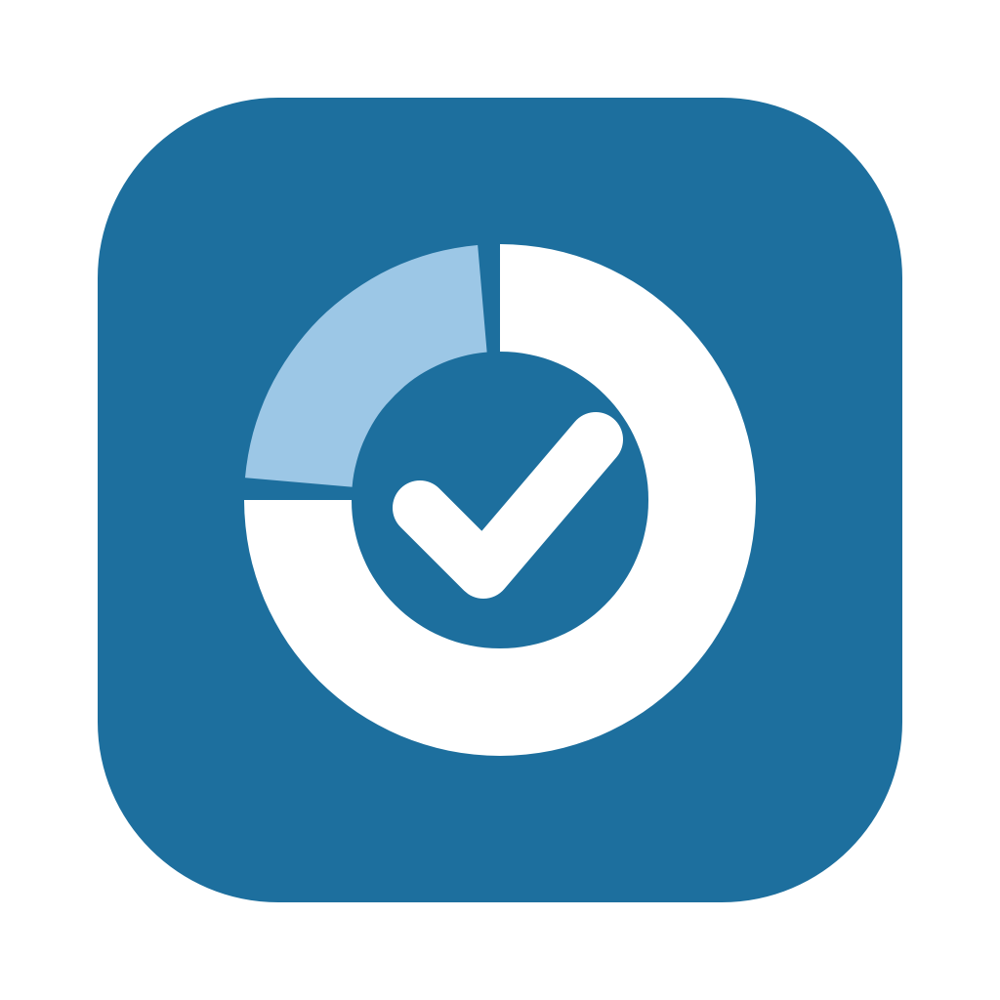

# Test Tracker

**[⬇ Install](#install)** · [Step-by-step guide](INSTALL.md) · [Latest release](https://github.com/shivthakar-vital/test-tracking/releases/latest)

A desktop dashboard for software release testing. It reads the team's test-tracking
**Google Sheet**, shows where testing stands at a glance, and lets you update cells, which
are written straight back to the sheet.



## Features

- **Dashboard** with a card per tab (percent done, with a bar split by status) and, for each
  tab:
  - a **status donut** with counts and percentages
  - **status by group** bars, e.g. by *System in Formal Test*, *Assignee*, *Equipment*, or
    *Workflow Type*
  - **runs per day**, for tabs with a date column
  - Hover over any chart for details. **Click a slice or bar** to jump to exactly those rows
- **Date filter** at the top of the dashboard: *Today*, *Yesterday*, *Last 7 / 30 days*,
  *This month*, *On a date…*, or a *Date range…*. It narrows every chart and card for tabs that
  have a date column (e.g. the end-to-end run trackers); other tabs show everything. Clicking
  a chart opens the table with the same dates applied. Your choice is remembered.
- **⬇ Export snapshot**: pick a date range (Today by default), tick which cards and charts to
  include (the defaults come from each card's ✎ Customize settings), and pick a layout:
  - **Wide** (default): cards in columns. The app balances the columns automatically, or open
    **Arrange the page** to drag cards between columns, drag the dividers to resize columns,
    add columns, and pick the page width. Your arrangement is remembered. Columns always end
    flush (the last card in each stretches), so unticking a card never leaves a gap.
  - **Slack summary + wide page**: a 16:9 summary PNG (headline numbers and key donuts) plus the
    wide page. **One column**, or **One image per card**.
  Saves a **PNG** and a matching **PDF** (run names, bug keys and notes are clickable), with a
  live preview.
  - **One combined Error Analysis (VitalOne + Viking)** (under the list of what to include):
    untick it to export a separate Error Analysis card for each tracker. Saved with profiles.
  - **Profiles**: save the whole setup (dates, layout, folder, what's ticked, the arrangement)
    with **Save as new…** and switch between them from the **Profile** menu. **Default** is the
    built-in settings and is always there. *● edited* means the settings differ from the chosen
    profile; **Save** updates it. Profiles are kept on your computer.
- **Bug summary** (tabs with *Created* and *Date Done* columns, like *Automated Bug Statuses*):
  cards for **Open now**, **New**, **Closed**, and **In QA**, a one-line summary, and lists of
  the new, closed, and in-QA bugs with clickable Jira keys. *New* and *Closed* follow the
  dashboard's date filter; the donut, *Open now*, and *In QA* are always as of now. Click a
  card to see those bugs.
- **One tab per sheet tab**, with:
  - **Search** across every column
  - **Filters** for dropdown and grouping columns (*Status ▾*, *Equipment ▾*…). Tick the values
    to show
  - **Sorting**: click a column header, and click again to reverse. Status sorts by
    progress, dates sort by date, and ticket numbers sort as numbers (PROD-2 before PROD-10)
  - **Wrap text** (on by default) shows long titles, paths and notes on several lines. Turn it off for a compact view
  - **Show empty rows** to reveal placeholder rows (e.g. run numbers with nothing filled in yet)
- **Edit in the app, saved to the sheet**: double-click a cell.
  - Dropdown columns show the sheet's own dropdown options, with *Select several…* for
    multi-select cells like `SMOKE, DRY`
  - Date columns get a calendar
  - Link cells (PROD tickets, run links) open on double-click. Change their text or URL with
    **Edit cell…** or by right-clicking
  - Notes open in a larger text box
- **+ Add row**: a form with the right control for each column. On run trackers it
  suggests the next run number, and fills the empty placeholder row for that number if
  there is one
- **Safe with several people editing**: before saving, the app checks that the cell still
  holds what you saw. If someone changed it meanwhile, it asks before replacing it. If rows
  were added or moved, it still finds the right row
- **Syncs every minute** (or click **↻ Sync**, ⌘R). If the connection drops, it keeps
  showing the last synced data
- **One-click updates**: a **⬆ Update** button appears when a new version is released

## How it adapts to new releases

Nothing about a particular release is built into the app. It reads the sheet's structure
every time it syncs:

- **Every visible tab** becomes a tab in the app. **Hidden tabs are ignored.**
- If a tab is a Google Sheets **Table** (*Format → Convert to table*), the app uses the
  table's **column types**: dropdown options become dropdowns, and date columns become date
  pickers. On plain tabs, the first row is the header, and dropdowns come from data
  validation.
- The **status column** is the dropdown whose name contains "Status" (e.g. *Current
  Status*). If a tab has several (*Coder E2E Status* and *Atlantis Status*), each row's
  status comes from the one that's filled in, preferring the one for the system the run
  was on.
- **End-to-end trackers** (tabs with a *Run Name* column) get a **Runs per Software Version**
  chart, newest version first, and a **Workflow Type** pie when that column is a dropdown.
  Trackers that can run on Coder (they have a *Coder … Status* column) also get a **Ran on**
  filter and a **Coder vs Atlantis** chart: a run named *Coder E2E* ran on Coder, any other
  name on Atlantis. Trackers that always run on Atlantis (like Viking) don't.
- **Filters and charts are strict by default.** Columns of generated or one-off values
  (names, links, IDs, serial numbers, notes, scripts, and version hashes other than
  *Software Version*) get no filter or chart. Other dropdowns and short, repeating text
  columns (like *System* or *Assignee*) do. *Workflow Type* and *Equipment* have filters
  but no charts. An admin can change any of this (see below).
- **Category pies:** dropdown columns named like *Why?*, *Reason*, *Cause*, *Category*, or *Workflow*
  get their own donut next to the status donut, with one fixed colour per option. Rows where
  the column is blank are left out, and pies with nothing in them are hidden. Click a slice to see those rows.
- **Error Analysis card:** a tab with a *… At Fault* column (e.g. *Subsystem At Fault*) or a
  *… Component* dropdown whose options look like `Subsystem - Component` (e.g.
  `HT - Precision Stepper`) gets a second card under its own. It shows the category pies
  (e.g. *Reason for Error Runs*), a **Subsystem At Fault** pie, and a **tally of every
  component grouped by subsystem**, including components with no runs yet. Subsystem
  colours match between the pie and the tally, and blanks are left out. Click anything
  to see those runs.
- **Resolved runs:** on trackers with a *Resolved?* date column, the Error Analysis card (and
  the export) shows **Resolved Issues from Failed Runs** (resolved vs not yet), a **Days to
  resolve** tally (same day, 1 day, 2 days, 3–6 days, 1–2 weeks, 2+ weeks), a summary (how
  many are resolved, the average and longest time, and how long the oldest open one has
  waited), and **Resolved, by subsystem** and **Unresolved, by subsystem** (the export shows
  only the unresolved one): the failed runs
  grouped by subsystem and component (runs with no component recorded are left out, as they're
  likely not a specific hardware issue). With a date filter (e.g. *Today*), these work like an
  end-of-day summary: failed runs from earlier days that are **still open** stay listed until
  they're resolved, and runs **resolved during** the range count as resolved even if they ran
  earlier. Days are the *Resolved?* date minus the run's date.
- **Repeated issues:** when a run tracker has a *Continued from Run#* column, a run that
  continues the error from an earlier run is part of the **same issue**. Error Analysis (the
  reason and subsystem pies, the component tally, resolved/unresolved, days to resolve, and the
  subsystem lists) counts each issue once. An issue is resolved when every run in it is, and
  days to resolve count from its first run. Run-based charts (run status, Coder vs Atlantis,
  runs per software version, per day) and the run list still show every run.
- **Ticket analysis** (tabs like *Hardware Support Tickets*: a *Subsystem* and/or *Components*
  column, values like `IA - Disc Stabilizer`): an **Analysis** card with a subsystem pie, a
  components tally by subsystem, a **Status** pie, and **Resolved /
  Unresolved, by subsystem** (dashboard only, not in the export). Tickets have no dates,
  so this is always "as of now".
- Blank cells show as **Unassigned** in assignee columns, and **No status** in status columns.
- Status colors follow meaning (an admin can change them; see *Admin: chart colours*): *Completed / Done / Results / Won't Do* are green, *In Progress*
  blue, *Error / Failed* red, *Blocked* dark purple, *Cancelled* orange, *No results* yellow, *Not Started /
  Created* gray, and *Deferred* dark gray.
- Tabs whose name contains **"Automated"** (filled in from Jira) are read-only in the app.

**To start a new release**, do either of these:

1. **New sheet file**: in Google Sheets, *File → Make a copy* (tick *Share it with the same
   people*, so the robot account keeps access), rename it (e.g. *v4.22 Test Tracker*), and
   clear out the old rows. In the app, pick **+ Add another release…** from the **Release**
   dropdown and paste the link. You can switch between releases from that dropdown.
2. **New tab in the same file**: duplicate a tab and rename it. It shows up by itself on the
   next sync.

## Admin: customize cards (charts, chart types, export)

Every dashboard card has a **✎ Customize** link (admin passcode). It opens an editor for
that tab's cards, with a live preview:

- **Charts on this card**: add (**+ Add chart**), remove, and reorder (↑ ↓) what the card shows.
- **Show as**: the chart type for each one — *Pie chart*, *Status bars, by column*, *Count
  bars*, *Tally, grouped by subsystem* (for “IA - Coils”-style values), *Per day* (date
  columns), *List of rows* (pick its columns), plus the special ones: *Status donut*, *Bug
  summary tiles*, *Bug list*, *Resolved vs not resolved*, *Resolved / unresolved, by subsystem*.
- **Column**, **Title**, **Count** (every row, or a repeated issue once), **Start a new row**.
- **Show on the dashboard** / **Include in the export**, per chart and per card. The export
  draws the very same card, so whatever you change here shows up there too.
- **+ New card** adds an extra card for the tab (e.g. one just for the export).
- **In the export, merge with the same card from other tabs** makes one card from several
  tabs (that's how Error Analysis covers VitalOne + Viking).
- **Reset this tab to built-in** goes back to the app's own choice. **Copy from another
  release…** reuses a layout saved in another release sheet for a tab with the same name.

Layouts are saved in the hidden settings tab (`layout:<tab name>`) and apply to everyone.
Columns are referred to by name, so moving or inserting columns doesn't break them. Tabs
nobody has customized show the built-in default (what 1.1.x showed).

**New columns**: when a column is added to a tab, its card shows *New column “X” — choose how
to show it*. **Choose…** opens the editor with a suggested chart already added (a pie for
reasons/causes, a tally for components, per day for dates, bars for other dropdowns).
**Not needed** hides the note for you.

## Admin: filters

Click **⚙ Settings → 🔎 Filters…** (admin passcode) to choose which columns get a **filter**
button on their tab. Choices are matched by column name, so turning off *Patient Name* turns
it off on every tab. They're saved in the hidden settings tab and apply to everyone.

## Admin: chart colours

Each status gets a colour automatically (see above). To choose your own:

1. Click **⚙ Settings → 🎨 Chart colours…**
2. The first time, set an **admin passcode**. After that, the app asks for it once per session.
3. Click a colour next to any status to change it. **Reset** goes back to the built-in colour.
4. Click **Save for everyone**.

The screen lists everything the charts colour, in sections: **statuses**, **subsystems**
(the *Subsystem At Fault* pie and the component tally), and the values of each category pie
(e.g. *Reason for Error Runs*, *Workflow Type*). The colours apply to every chart, summary
card, status dot, and export, for everyone using that release sheet, after their next sync
(within a minute). Everything is matched by name, so *Blocked* or *IA* gets the same colour
on every tab and in the combined export.

Built-in colours: **green is only for finished statuses** (Done, Completed, RUN _COMPLETED,
Results, Closed, Won't Do…), **red is only for errors** (Error, Failed), **Blocked is dark
purple**, **Cancelled is orange**, and *In Review* is cyan. Categories and subsystems use a
10-colour palette with no green, red, or Blocked purple, ordered so neighbouring colours stay
distinct for colourblind readers.

The colours and passcode are saved in a hidden tab of the sheet called
**Test Tracker Settings**, so a release sheet made with *File → Make a copy* keeps them. The
passcode is stored only as a one-way hash.

> The passcode keeps people from changing colours by accident. It isn't strong security:
> anyone who can edit the Google Sheet could also edit the hidden tab.

**Forgot the passcode?** In Google Sheets, open **View → Hidden sheets → Test Tracker
Settings**, delete the `admin_passcode` row, and hide the tab again. The next time you open
🎨 Chart colours, the app asks you to set a new passcode. Your colours are kept.

## Install

**On any Apple Silicon Mac**, paste this into Terminal:

```bash
curl -fsSL https://raw.githubusercontent.com/shivthakar-vital/test-tracking/main/install.sh | bash
```

See **[INSTALL.md](INSTALL.md)** for step-by-step instructions to share with coworkers.

### Building it yourself

`./build_mac.sh --install` builds `Test Tracker.app` from source and copies it to
`/Applications`. Drop `--install` to only build into `dist/`.

To publish a new version for everyone, bump `APP_VERSION` at the top of `test_tracker.py`,
commit, and push a matching tag (e.g. `v1.0.1`). GitHub Actions checks that the two match,
builds the app, and attaches it to a GitHub Release. The install line downloads it, and the
app's **⬆ Update** button installs it.

### Stable and testing builds

`APP_CHANNEL` next to `APP_VERSION` is `"stable"` or `"testing"`. A testing version is
published as a GitHub **pre-release**: the install line and the ⬆ Update button on stable
copies never pick it up, so coworkers stay on the stable build. Testing copies are offered
newer testing *and* stable versions.

- Stable: **v1.1.7** (on `main`). Next stable: **v2.0.0**.
- Testing: **v1.2.x** (on the `v2` branch) — the 2.0 overhaul while it's being tried out.

**Going back a version:** ⚙ Settings → **Versions…** lists every published version; pick one
and click **Install this version** (the app closes, installs it, and reopens). Or in Terminal:

```bash
curl -fsSL https://raw.githubusercontent.com/shivthakar-vital/test-tracking/main/install.sh | TRACKER_ZIP_URL=https://github.com/shivthakar-vital/test-tracking/releases/download/v1.1.7/Test-Tracker-mac.zip bash
```

**Windows:** run `build_windows.bat` on a Windows PC with Python 3. The app ends up in
`dist\Test Tracker\Test Tracker.exe`.

**Run from source (for development):**

```bash
python3 -m venv .venv && .venv/bin/pip install -r requirements.txt
.venv/bin/python test_tracker.py
```

## Connect a Google Sheet

The app signs in to Google with a *service account*: a robot Google account that you share
the sheet with. It uses the same kind of key as Qave Inventory. **If Qave Inventory is set
up on this Mac, Test Tracker reuses its key automatically.**

To set up a new one (about 10 minutes):

1. **Create a Google Cloud project** at <https://console.cloud.google.com/>.
2. **Enable the API**: *APIs & Services → Library*, search for **Google Sheets API**, and
   click **Enable**.
3. **Create the service account**: *APIs & Services → Credentials → Create credentials →
   Service account*. Name it and click **Done**.
4. **Download a key**: click the service account, then *Keys → Add key → Create new key →
   JSON*. Keep the file private.
5. **Share the sheet** with the service account's email (e.g.
   `inventory-bot@qave-inventory.iam.gserviceaccount.com`) as an **Editor**.
6. **Configure the app**: click **⚙ Settings**, paste the sheet link, click **Add**, then
   **Choose key file…**, and **Save**.

## Files

| File | What it is |
|------|------------|
| `test_tracker.py` | The app: window, dashboard, tables, editing, updates |
| `tracker_store.py` | Reading and writing the Google Sheet, settings, and the offline cache |
| `charts.py` | The donut, bar, per-day, and tally charts (drawn with Qt, no extra libraries) |
| `layout.py` | Card layouts: what each card shows, built-in defaults, saved customizations |
| `blocks.py` | Draws each kind of chart/list in a card, for both the dashboard and the export |
| `export_report.py` | The snapshot export: arranges the cards and saves the PNG(s) and PDF |
| `install.sh` | The one-line installer and updater |
| `build_mac.sh` | Builds the `.app` |
| `.github/workflows/release.yml` | Builds and publishes a release when a `v*` tag is pushed |

Settings, the key, and the offline cache live in `~/Library/Application Support/TestTracker`.
